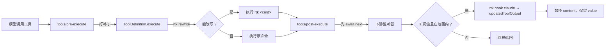

<p align="center">
  
</p>

<p align="center">
  <a href="./README.md">English</a> · <strong>中文</strong>
</p>

<p align="center">
  <a href="https://www.npmjs.com/package/dsh-rtk-workbench"></a>
  <a href="https://www.npmjs.com/package/dsh-rtk-workbench"></a>
  <a href="LICENSE"></a>
</p>

<p align="center">
  <em>把 <a href="https://github.com/rtk-ai/rtk">rtk（Rust Token Killer）</a> 接进 DeepSeek Harness，而且把二进制一起带上。</em><br>
  <sub>能改写的改写 · 改不动的压缩 · 告诉模型发生了什么</sub>
</p>

## Why this exists

rtk 站在 agent 和工具之间：把命令改写成过滤版，并在模型读到工具输出之前先压一遍。它为 20 个
agent 各自实现了适配层（Claude Code 是一个 `PreToolUse` hook），而 DSH 此前没有；现有 DSH 插件
也只补了"改写"这半边。

- 没有输出压缩：rtk 改写不了的命令（`node build.js`、大日志、MCP 调用）仍把完整输出灌进上下文。
- 没有上下文说明：模型看到 `[... elided ...]` 以为结果不全，重跑一次命令，token 花两遍。
- 没有内置二进制：一个"得先从别处装 rtk 才能工作"的插件，等于静默什么都不做。

这个插件把三件事一起补上，并且所有失败路径都保持开放：rtk 不存在、超时、返回意料之外的东西时，
工具调用和没装这个插件时完全一样。

## What you get

| 能力 | 默认 | 实现方式 |
|---|---|---|
| **命令改写** | 开 | 包装 `ToolDefinition.execute`；`git status` 以 `rtk git status` 执行，超过 500 B 的结果首行是 `[rtk] ran: rtk git status`；rtk 跑不起来时重放原命令并标注 `[rtk] fell back:` |
| **输出压缩** | 开（≥ 2048 B） | 在 `tools/post-execute` 里用合成的 PostToolUse 事件调 `rtk hook claude`；文件/搜索结果默认跳过，小的测试/构建输出用按命令族阈值 |
| **恢复** | 开 | 保留 rtk 的 `rtk recall <hash>` 提示；沙箱够不到 rtk 库时，原文落到会话私有存储并在结果里给出路径 |
| **会话可见性** | 开 | `/rtk status` 追加本会话省量与跳过原因；`/rtk stats [--json]` 是完整报告 |
| **上下文说明** | 开 | 一节静态提示，解释 `[rtk] ran:`、`[rtk] fell back:`、省略标记、`rtk recall` 与保存路径；只在确认 rtk 可用后注入 |
| **内置 rtk** | 开 | 二进制以分平台可选依赖随包分发；`rtkSource: 'path'` 可关掉 |
| **rtk `deny` 规则** | 关 | 给 `rtk hook claude` 喂 PreToolUse 事件并遵守 `permissionDecision: deny`；DSH 没有宿主权限规则，保持关闭 |
| **`/rtk` 命令组** | 常驻 | `status`、`stats`、`tools`、`explain`、`doctor`、`gain`、`recall <hash>`、`help [topic]`、按开关的 `on`/`off` |

这里没有任何一条是"注册新工具""替换 shell 执行器"或"碰模型 API"。

## Install

**插件面板安装** —— 在 *Add plugin* 里搜 `dsh-rtk-workbench`，点安装；或者：

```sh
dsh plugin --profile web add dsh-rtk-workbench
```

**或者直接装 GitHub Release 的包**：

| 平台 | 产物 |
|---|---|
| Windows x64 | `dsh-rtk-workbench-win32-x64.tgz` |
| macOS Intel | `dsh-rtk-workbench-darwin-x64.tgz` |
| macOS Apple silicon | `dsh-rtk-workbench-darwin-arm64.tgz` |
| Linux x64 | `dsh-rtk-workbench-linux-x64.tgz` |
| Linux arm64 | `dsh-rtk-workbench-linux-arm64.tgz` |

装完**重启宿主**（bundle 变更不是刷新页面）。**不需要单独安装 rtk**：平台二进制是本包的可选依赖。

## Quick start

```
/rtk status     # 二进制、来源、pipeline 健康、开关、本会话省量
/rtk stats      # 本会话完整报告（--json 给机器读）
/rtk doctor     # 深度自检：版本、pipeline、一次真实往返、recall、trust
/rtk tools      # 每个可见工具是怎么解析到的（规范名 / 别名 / 显式配置）
/rtk explain "git status"   # 为什么这条命令会/不会被改写
```

之后正常干活即可：大仓库里的 `git status` 变成一行一个文件的紧凑结果，首行是
`[rtk] ran: rtk git status`；`cat` 一个 100 KB 日志会被压缩并指向 `rtk recall <hash>`——
沙箱会话里则给出 `[rtk] original saved: <路径>`，可直接读。

## How it works



改写靠包装 `execute`（不是重派发），保留注册表的信号融合与记账；压缩永远先 `await next()`，
安全插件与 spill 策略照常生效。详细规则在参考手册里。

## Measured effect

| 用例 | 路径 | 之前 | 之后 | 降幅 |
|---|---|---:|---:|---:|
| `git status` | 改写 | 377 B | 47 B | −87.5 % |
| `grep -rn TODO src`，300 处命中 | 改写 | 20 364 B | 2 190 B | −89.2 % |
| pytest 输出，2 001 行 | 压缩 | 89 505 B | 11 287 B | −87.4 % |
| `package-lock.json`，read 形状 | 压缩 | 76 896 B | 4 654 B | −93.9 % |

`node scripts/benchmark.mjs` 在确定性 fixture 上复现；fixture 是刻意构造的，
对外引用前请在你自己的工作负载上重跑。这里是字节数不是 token 数；阈值依据见参考手册。


## Documentation

- [参考手册](./docs/reference.zh.md) —— 命令、配置、恢复、兼容矩阵、排障、设计说明。
- [Reference manual (English)](./docs/reference.md)。

## Development

```sh
pnpm install
node node_modules/typescript/bin/tsc --noEmit
node node_modules/vitest/vitest.mjs run
node node_modules/tsdown/dist/run.mjs          # 构建 lib/
node scripts/build-vendor.mjs                  # 打包 rtk（下载约 31 MB，有缓存）
node scripts/release.mjs --dry-run             # 打印发布计划
node scripts/check-manifest.mjs                # 包级要求（解析 YAML、peers、files、展示元数据）
node scripts/check-docs.mjs                    # README 中英配对与相对链接完整性
```

`scripts/smoke-rtk.mjs <binary>` 验证某个平台的内置二进制；CI 在每个随包分发的平台上跑一次，
单测在 Ubuntu、macOS arm64 与 Windows 上跑。

## Credits

压缩规则、过滤器与 `hook` 协议都是 [rtk](https://github.com/rtk-ai/rtk) 的工作；本插件是
DeepSeek Harness 侧的适配层，原样分发 rtk 二进制。该二进制本体是 Apache-2.0，并链接了以
BUSL-1.1 授权的 `rtk-engine`（source-available；生产使用免费，2030-09-09 起转为 Apache-2.0，
但不允许把 rtk 作为付费或托管产品对外提供）。两份许可文本随包分发，见 [`licenses/`](./licenses)。

## License

[Apache License 2.0](./LICENSE) © 2026 dsh-rtk-workbench contributors.
