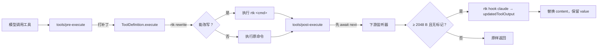

<p align="center">
  
</p>

<p align="center">
  <a href="./README.md">English</a> · <strong>中文</strong> · <a href="./README-es.md">Español</a> · <a href="./README-hi.md">हिन्दी</a> · <a href="./README-pt.md">Português</a>
</p>

<p align="center">
  <a href="https://www.npmjs.com/package/dsh-rtk-workbench"></a>
  <a href="https://www.npmjs.com/package/dsh-rtk-workbench"></a>
  <a href="LICENSE"></a>
</p>

<p align="center">
  <em>把 <a href="https://github.com/rtk-ai/rtk">rtk（Rust Token Killer）</a> 接进 DeepSeek Harness，而且把二进制一起带上。</em><br>
  <sub>能改写的改写 · 改不动的压缩 · 告诉模型发生了什么</sub>
</p>

## Why this exists

rtk 的定位是站在 agent 和工具之间：把命令改写成过滤版，并在模型读到工具输出之前先压一遍。它开箱支持 20 个 agent——**DeepSeek Harness 不在其中**。

现有的 DSH 插件只补了一半：全部实现的是*命令改写*，到这就停了，于是 rtk 另外三分之二的价值被浪费：

| 缺口 | 后果 |
|---|---|
| 没有输出压缩 | rtk 改写不了的命令（`node build.js`、`cat big.log`、MCP 调用）依然把完整输出灌进上下文 |
| 没有上下文说明 | 模型看到 `[... elided ...]` 会以为结果不全，重跑一次命令拿"真结果"，token 花两遍 |
| 需要用户自己装 rtk | 一个"必须先从别处装点东西才能工作"的插件，等于静默什么都不做 |

这个插件把三件事一起补上，并且所有失败路径都保持开放：rtk 不存在、超时、返回意料之外的东西时，工具调用和没装这个插件时完全一样。

## What you get

| 能力 | 默认 | 实现方式 |
|---|---|---|
| **命令改写** | 开 | 包装 `ToolDefinition.execute`；`git status` 实际以 `rtk git status` 执行，超过 500 字节的结果首行是 `[rtk] ran: …`，让实际命令可见 |
| **输出压缩** | 开（≥ 2048 B） | 在 `tools/post-execute` 里用合成的 PostToolUse 事件调 `rtk hook claude`，用压缩后的文本替换 content，canonical value 仍然留给 `run_code` |
| **上下文说明** | 开 | 一节静态系统提示，解释 `[rtk] ran:`、省略标记与 `rtk recall` |
| **内置 rtk** | 开 | 二进制以分平台可选依赖随包分发，不需要另装；`rtkSource: 'path'` 可关掉 |
| **rtk `deny` 规则** | 关 | 给 `rtk hook claude` 喂 PreToolUse 事件，遵守 `permissionDecision: deny` |
| **`/rtk` 命令组** | 常驻 | `status`、`tools`、`doctor`、`gain`、`recall <hash>`，以及按开关的 `on` / `off` |

这里没有任何一条是"注册新工具""替换 shell 执行器"或"碰模型 API"。

## Install

**插件面板安装** —— 在 *Add plugin* 里搜 `dsh-rtk-workbench`，点安装。

**命令行安装：**

```sh
dsh plugin --profile web add dsh-rtk-workbench
```

**或者直接装 GitHub Release 的包**，不经过 registry。按平台选一个：

| 平台 | 产物 |
|---|---|
| Windows x64 | `dsh-rtk-workbench-win32-x64.tgz` |
| macOS Intel | `dsh-rtk-workbench-darwin-x64.tgz` |
| macOS Apple silicon | `dsh-rtk-workbench-darwin-arm64.tgz` |
| Linux x64 | `dsh-rtk-workbench-linux-x64.tgz` |
| Linux arm64 | `dsh-rtk-workbench-linux-arm64.tgz` |

```sh
# `latest/download/` 永远指向最新 release，升级后这条链接依然有效
dsh plugin --profile web add https://github.com/YunaAloft/dsh-rtk-workbench/releases/latest/download/dsh-rtk-workbench-win32-x64.tgz
```

产物文件名刻意不带版本号：带了的话每次发版都会让 `releases/latest/download/` 链接失效。想知道装上的是哪个版本，看 `/rtk status` 或 release tag。

装完**重启宿主**（bundle 变更不是刷新页面）。**你不需要单独安装 rtk**——平台二进制是本包的可选依赖：

| # | 解析顺序 |
|---|---|
| 1 | `rtkPath` 配置 |
| 2 | `RTK_BIN` / `DSH_RTK_BIN` |
| 3 | 内置平台包（release tarball 里是 `vendor/`） |
| 4 | `PATH` 上的 `rtk` |

平台包下载失败时只是跳过这一级，插件退化成"用你自己装的 rtk"，而不是直接不可用。

## Quick start

```
/rtk status     # 二进制、来源、pipeline、开关、哪些工具被打了补丁
/rtk doctor     # 深度自检：版本、pipeline、一次真实往返、recall
/rtk tools      # 每个可见工具是怎么解析到的（规范名 / 别名 / 显式配置）
```

之后正常干活即可：

- 在大仓库里让它跑 `git status` → 结果首行是 `[rtk] ran: …`，正文是一行一个文件的紧凑格式（干净的小仓库故意不加标注：那时那行的成本比省下的还高）；
- 让它 `cat` 一个 100 KB 的日志 → 结果被压缩，末尾带 `[full output: rtk recall <hash>]`；
- 把那个 hash 贴回去，让它跑 `rtk recall <hash>` → 原文完整回来。

## How it works



三个细节决定正确性，每一个都是踩了真 bug 才定下来的：

1. **打补丁，而不是重新派发。** 在 `tools/execute` 里跳过 `next()` 自己去调 `execute`，会丢掉注册表的信号融合和 `bodyInvoked` 记账，取消语义随之退化。包装 `execute` 保留了那套机制，只替换一个参数。
2. **先 `await next()`。** `tools/post-execute` 里提前 return 会把后面所有监听器短路，包括别的插件要追加的提示。
3. **标注绝不能吃掉正文。** 结果读不出文本、或工具本就不可压缩时，标注要么作为独立块前置，要么直接放弃——不能反过来。

## Measured effect

用 `node scripts/benchmark.mjs` 可以复现：脚本会建一个确定性的 fixture 仓库，每个用例测两次——一次原样，一次走插件完全相同的路径（改写走 `rtk <命令>`，压缩走合成的 PostToolUse 事件 + `rtk hook claude`）。

| 用例 | 路径 | 之前 | 之后 | 降幅 | 估算 token |
|---|---|---:|---:|---:|---:|
| `git status` | 改写 | 377 B | 47 B | −87.5 % | 95 → 12 |
| `git log`，20 个提交 | 改写 | 3 578 B | 1 698 B | −52.5 % | 895 → 425 |
| `git diff`，100 行改动 | 改写 | 20 511 B | 6 945 B | −66.1 % | 5 128 → 1 737 |
| `ls -la` | 改写 | 508 B | 138 B | −72.8 % | 127 → 35 |
| `grep -rn TODO src`，300 处命中 | 改写 | 20 364 B | 2 190 B | −89.2 % | 5 091 → 548 |
| pytest 输出，2 001 行 | 压缩 | 89 505 B | 11 287 B | −87.4 % | 22 377 → 2 822 |
| 应用日志，5 000 行 | 压缩 | 272 640 B | 13 633 B | −95.0 % | 68 160 → 3 409 |
| `package-lock.json`，`read` 形状 | 压缩 | 76 896 B | 4 654 B | −93.9 % | 19 224 → 1 164 |
| **合计（每项各跑一次）** | | **484 379 B** | **40 592 B** | **−91.6 %** | **121 095 → 10 148** |

> 这是字节数不是 token 数：token 列是 `bytes / 4` 的估算，按 ASCII 为主的英文与代码估的，请当成量级看。fixture 是刻意构造的（重复日志、300 个 `TODO` 的文件、生成的 lockfile），所以对外引用前，请在你自己的工作负载上重跑这个脚本。

一次往返的时延（30 样本，`process.hrtime`）：

| 操作 | p50 |
|---|---|
| `rtk --version`（仅进程启动） | 50 ms |
| `rtk hook claude`，8.4 KB payload | 96 ms |
| `rtk rewrite "git status"` | 206 ms |
| 宿主进程里第一次 spawn | 2.7–5.8 s（平台在扫 17 MB 未签名二进制） |

这就是为什么压缩阈值取 2048 字节、为什么已带 `rtk` 前缀的命令一次进程都不花、以及为什么启动探测单独给预算而不是阻塞工具调用。

## Coexistence

这个插件是为了和别的东西并存而写的：

- **不抢 `ctx.shell`。** 改写靠包装已注册的工具实现，替换 shell 执行器的插件照常工作。
- **永远先 `await next()`。** 安全插件那句"这条命令没被检查过"、spill 策略，都还能跑。
- **不点名、不阻塞任何插件。** 如果下游已经替换过某次结果的内容，插件会发现（一次内容差异比较，仅此而已），继续工作，并在 `/rtk status` 里写 `observed: another result transformer changed N result(s)`。

## Configuration

每个开关都是 Schemastery schema；非法值在加载期就报错，而不是运行时才炸。

| 键 | 类型 | 默认值 | 说明 |
|---|---|---|---|
| `rtkPath` | string | `''` | 显式路径；空 = `RTK_BIN` / `DSH_RTK_BIN` / 内置 / `PATH` |
| `rtkSource` | string | `'auto'` | `auto` 优先内置二进制；`path` 强制走 `PATH` |
| `timeoutMs` | number | `2000` | 单次调用预算；超时视为不改写、不压缩 |
| `rewriteEnabled` | boolean | `true` | 改写总开关 |
| `shellTools` | string[] | `['bash','pwsh']` | 用于识别 shell 的工具名 |
| `rewriteTools` | string[] | `['bash','ops_bash','pwsh']` | 允许改写；本地预过滤会跳过 PowerShell cmdlet 与 `$` 表达式（rtk 对它们一律 defer） |
| `compressEnabled` | boolean | `true` | 压缩总开关 |
| `compressTools` | string[] | `['*']` | 允许压缩的工具；`*` = 所有工具的文本结果 |
| `excludeTools` | string[] | `[]` | 任何情况下都不碰 |
| `compressThresholdBytes` | number | `2048` | 低于此值不值得花约 96 ms |
| `maxPayloadBytes` | number | `2097152` | 高于此值跳过（rtk 的 hook stdin 上限 64 MiB） |
| `awarenessEnabled` | boolean | `true` | 是否注入上下文说明 |
| `denyEnabled` | boolean | `false` | 是否遵守 rtk 的 `deny` 判定 |
| `pipelineMode` | string | `'plugin-owned'` | `plugin-owned` 注入 `RTK_CONFIG_DIR`；`user` 用你自己的 pipeline 文件 |
| `annotateRewrites` | boolean | `true` | 是否前置 `[rtk] ran:` 行 |
| `annotateMinBytes` | number | `500` | 结果短于此值时不加那行标注——标注里带完整路径，对很小的输出来说比省下的还贵 |

`RTK_DB_PATH` 与 `RTK_TEE_DIR` **刻意不覆盖**：`rtk recall` 是模型在普通 shell 里跑的，重定向 tee/DB 会让恢复彻底失效。

## Troubleshooting

**`/rtk status` 说 `rtk is not usable`。** 那一行会写明原因（`spawn`、`timeout` 或 `exit`）。新进程里第一次 spawn 可能要好几秒——`timeout` 通常是平台在扫二进制，不是装坏了。如果写的是 `via path`，说明你平台的内置包没装上；设置 `rtkPath` 或自己装 rtk 即可。

**压缩从来不触发。** 先看 `/rtk tools`：没有 `compress` 标记的工具不在 `compressTools` 里，或者结果小于 `compressThresholdBytes`。如果命令被改写过了，跳过压缩是**正确**的——rtk 已经产出紧凑输出了。

**改写从来不触发。** `Get-ChildItem`、`$env:PATH` 是 PowerShell 语法，rtk 本来就 defer，插件连一次进程都不花。`git status`、`cargo test`、`docker ps`、`ls` 都会正常改写。

**`rtk recall` 报 store 错误。** 工具所在的 shell 被沙箱限制（`workspace-write`），读不到 `%APPDATA%` 下 rtk 的数据库；插件自己在宿主进程里，不受这个限制。让用户改用 `/rtk recall <hash>`——斜杠命令在宿主里执行，读的是同一个库。

**同时装了两个压缩器。** 当下游替换过结果内容时，`/rtk status` 会显示 `observed: another result transformer …`。不会坏，但通常只留一个更好——`/rtk off compress` 可以临时关掉这个。

**全新 profile 里什么都不生效。** Windows 的 profile 可能只有 `pwsh` 工具。压缩和"改写真实程序"都不需要 bash；只有装了 shell 插件才会出现 `bash` 工具。

## Development

```sh
pnpm install
node node_modules/typescript/bin/tsc --noEmit
node node_modules/vitest/vitest.mjs run
node node_modules/tsdown/dist/run.mjs          # 构建 lib/
node scripts/build-vendor.mjs                  # 打包 rtk（下载约 31 MB，有缓存）
node scripts/release.mjs --dry-run             # 打印发布计划
npx dsh-plugin-dev check --cwd . --strict
npx dsh-plugin-dev verify --cwd . \
  --base @deepseek-ai/dsh-base@0.2.1-rc.5 \
  --headless @deepseek-ai/dsh-headless@0.2.1-rc.5
```

`scripts/smoke-rtk.mjs <binary>` 用来验证某个平台的内置二进制能跑；CI 在 ubuntu、macOS（x64/arm64）与 Windows 上各跑一次，单测也是同样四个目标。

**发布。** 先全量构建（`node scripts/build-vendor.mjs` 不带 `--only`），再按顺序发布五个平台包和主包：

```sh
node scripts/release.mjs --yes --registry https://registry.npmjs.org
gh release create v0.1.0 dist/github/*.tgz dist/github/checksums.txt dist/github/manifest.json \
  --title "dsh-rtk-workbench v0.1.0 (rtk 1.1.0)" --generate-notes
```

顺序不能反：主包把平台包列为 `optionalDependencies`，先发主包会让所有安装解析不到二进制。

## Credits

压缩规则、过滤器与 `hook` 协议都是 [rtk](https://github.com/rtk-ai/rtk) 的工作（Apache-2.0）；本插件是 DeepSeek Harness 侧的适配层，原样分发 rtk 1.1.0。其许可证副本见 [`licenses/rtk-LICENSE`](./licenses/rtk-LICENSE)。

## License

[Apache License 2.0](./LICENSE) © 2026 dsh-rtk-workbench contributors.
