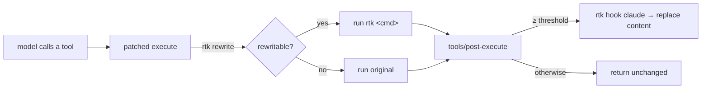

<p align="center">
  
</p>

<p align="center">
  <strong>English</strong> · <a href="./README.md">中文</a>
</p>

<p align="center">
  <a href="https://www.npmjs.com/package/dsh-rtk-workbench"></a>
  <a href="https://www.npmjs.com/package/dsh-rtk-workbench"></a>
  <a href="LICENSE"></a>
</p>

<p align="center">
  <em><a href="https://github.com/rtk-ai/rtk">rtk (Rust Token Killer)</a> wired into DeepSeek Harness, binary included.</em><br>
  <sub>rewrite what rtk can rewrite · compress the rest · show what it saved</sub>
</p>

## Why this exists

rtk sits between the agent and its tools: it rewrites a command into a filtered form and condenses output before the model reads it. It ships adapters for twenty agents — DSH is not one of them, and the community plugins for DSH cover only half of either half.

This plugin closes the loop: **rewrite** (delegated to rtk's rules), **compress** (rtk's own method chain, no reimplementation), **show** (savings land in the counters and are visible in the UI). Every failure path stays open: with rtk missing, slow or answering something unexpected, a tool call behaves exactly as if this plugin were not installed.

## What you get

| Capability | Default | Notes |
|---|---|---|
| **Command rewriting** | on | `git status` runs as `rtk git status`; the result starts with `[rtk] ran:`, or `[rtk] fell back:` plus the original command when rtk itself failed |
| **Semantic guard** | on | Proves the rewrite still runs the original command; `next build` maps to `rtk next` (rtk injects `build`), proposals that drop an argument are refused and the original runs |
| **Output compression** | on (≥ 2 KB) | `rtk hook claude` condenses large output; file and search results are skipped by default |
| **Recovery** | on | Keeps `rtk recall <hash>`; when a sandbox cannot reach rtk's store the original is spilled and its path named |
| **Visible savings** | on | Token estimate (ASCII ÷4, CJK ×0.6) plus cross-restart totals; `/rtk stats` for detail, the pill for a glance |
| **/rtk commands** | always | `status`, `stats`, `tools`, `explain`, `doctor`, `gain`, `recall`, `on/off` |

No new tools, no shell-executor replacement, no model API changes.

## Install

Search `dsh-rtk-workbench` in the **plugin panel**, or:

```sh
dsh plugin --profile web add dsh-rtk-workbench
```

**Restart the host** afterwards (a bundle change is not a page refresh). **rtk itself is not required** — platform binaries ship with the package for Windows x64, macOS x64/arm64 and Linux x64/arm64; other platforms are covered in the [reference manual](./docs/reference.md).

## Quick start

```
/rtk status            # binary, pipeline, switches, this session's savings
/rtk explain "next build"   # why a command would (not) be rewritten
/rtk off ui            # hide the savings pill above the composer
/rtk stats             # full report; --json for machines
```

Then work as usual: `git status` in a large repository becomes a compact listing; `cat` on a 100 KB log is condensed and points at `rtk recall <hash>` — or at a spilled file the sandbox can read.

## How it works

Rewriting wraps `ToolDefinition.execute` (it does not re-dispatch), keeping the registry's signal fusion and accounting intact. Compression runs in `tools/post-execute`, always after `await next()`, so safety plugins and the spill policy still apply.



Browser side: the host half serves one read-only `GET /api/rtk-workbench/status`; the browser half renders `saved X token · −N%` above the composer, with a details overlay behind it.

## Measured effect

Deterministic benchmark total: **463 507 B → 38 265 B (−91.7 %)**, about 115.9k → 9.6k estimated tokens; per case from −87.5 % (`git status`) to −95.0 % (a 5 000-line log).

The full table, how to reproduce it and what those numbers do **not** prove are in [the benchmark](./docs/benchmark.md). Tokens are estimates, not provider billing.

## Documentation

- [Reference manual](./docs/reference.md) — commands, config, recovery, compatibility matrix, troubleshooting, design notes
- [Benchmark](./docs/benchmark.md) — reproducible fixture numbers and their limits
- [Compatibility ledger](./docs/compatibility.md) — verified hosts, declared ranges, `verify-host`
- [Changelog](./CHANGELOG.md) — what each release changed

## Development

```sh
pnpm install
pnpm typecheck          # both compiler faces: host and client
pnpm test
pnpm build              # lib/index.js (host) + lib/client.js (browser)
```

More scripts (`benchmark`, `release`, `check-manifest`, `check-docs`) are listed in the reference manual.

## Credits

Filtering rules, filters and the `hook` protocol are [rtk](https://github.com/rtk-ai/rtk)'s work; this plugin is the DeepSeek Harness adapter and redistributes the rtk binary unchanged (Apache-2.0, linked against the BUSL-1.1 `rtk-engine`; both license texts ship in [`licenses/`](./licenses)).

## License

[Apache License 2.0](./LICENSE) © 2026 dsh-rtk-workbench contributors.
