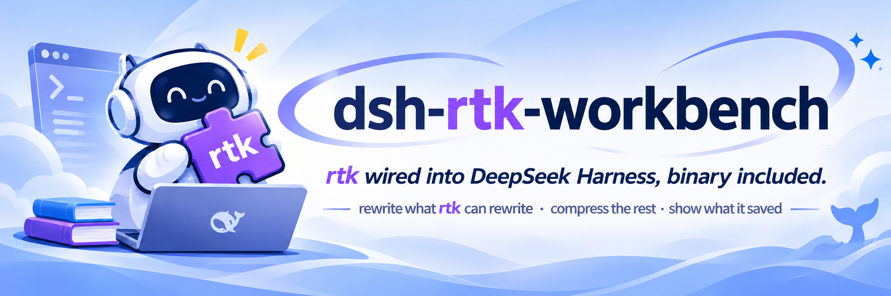
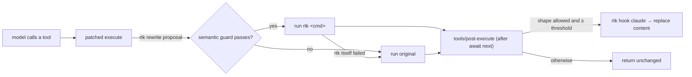

<p align="center">
  
</p>

<p align="center">
  <strong>English</strong> · <a href="./README.md">中文</a>
</p>

<p align="center">
  <a href="https://www.npmjs.com/package/dsh-rtk-workbench"></a>
  <a href="https://www.npmjs.com/package/dsh-rtk-workbench"></a>
  <a href="https://github.com/YunaAloft/dsh-rtk-workbench/actions/workflows/ci.yml"></a>
  <a href="https://github.com/YunaAloft/dsh-rtk-workbench/releases/latest"></a>
  
  <a href="LICENSE"></a>
</p>

<p align="center">
  <em><a href="https://github.com/rtk-ai/rtk">rtk</a> wired into DeepSeek Harness, binary included.</em><br>
  <sub>rewrite what rtk can rewrite · compress the rest · show what it saved</sub>
</p>

## Why this exists

rtk (Rust Token Killer) sits between the agent and its tools: it rewrites a command into a filtered form and condenses output before the model reads it. It ships adapters for 18 AI tools (as of rtk 1.2.0) — DSH is not one of them — and the community plugins for DSH each cover only part of rewriting or trimming. This plugin closes the loop: **rewrite** (delegated to rtk's rules), **compress** (rtk's own method chain, no reimplementation), **show** (savings land in the counters and are visible in the UI). Every failure path stays open: with rtk missing, slow or answering something unexpected, a tool call behaves exactly as if this plugin were not installed. It registers no new tool, replaces no shell executor and touches no model API.

## What you get

| Capability | Default | Notes |
|---|---|---|
| **Command rewriting** | on | `git status` runs as `rtk git status` and the result starts with `[rtk] ran:`; the semantic guard proves the rewrite still runs the original command (`next build` maps to `rtk next`, a proposal that drops an argument is refused), and a failed rewrite replays the original with `[rtk] fell back:` |
| **Output compression** | on (≥ 2 KB) | `rtk hook claude` condenses large output; file and search results are skipped by default; `rtk recall <hash>` stays available, and a sandboxed shell gets a spilled path it can read |
| **Visible savings** | on | Token estimate (ASCII ÷4, CJK ×0.6) plus cross-restart totals, and this conversation's numbers survive a restart too; the pill is there at a glance, `/rtk stats` has the detail |
| **/rtk commands** | always | `status`, `stats`, `tools`, `explain`, `doctor`, `gain`, `recall`, `on/off` |

## Install

Search `dsh-rtk-workbench` in the **plugin panel**, or:

```sh
dsh plugin --profile web add dsh-rtk-workbench
```

You can also install the GitHub release asset `dsh-rtk-workbench-<platform>.tgz`. **Restart the host** afterwards (a bundle change is not a page refresh). **rtk itself is not required** — platform binaries ship with the package for Windows x64, macOS x64/arm64 and Linux x64/arm64; other platforms are covered in the [reference manual](./docs/reference.en.md).

## Quick start

```
/rtk status     # binary, pipeline, switches, this session's savings
/rtk stats      # full report; --json for machines
/rtk off ui     # hide the savings pill for good (writes the profile config; stays hidden across restarts until /rtk on ui)
```

Then work as usual: `git status` in a large repository becomes a compact listing; `cat` on a 100 KB log is condensed and points at `rtk recall <hash>` — or at a spilled file the sandbox can read. `status`, `stats`, `tools`, `explain`, `doctor` and `recall` are documented in the reference manual.

## Reporting a problem

- After updating or reinstalling the plugin, **fully quit and reopen DSH** first and check whether the problem is still there.
- When filing a bug, please include `dsh --version`, the plugin version and install method, and your OS/architecture.
- Running `/rtk doctor` is recommended; paste its output into the issue — it contains no command text or tool output, so it is safe to share.
- For bugs, please use the [bug report form](https://github.com/YunaAloft/dsh-rtk-workbench/issues/new?template=bug_report.yml) and describe what happened, what you expected, and attach a screenshot if possible.

## How it works

- **Rewrite**: wraps `ToolDefinition.execute` (it does not re-dispatch), keeping the registry's signal fusion and accounting intact; rtk's proposal must pass the semantic guard, and a failed rewrite replays the original command marked `[rtk] fell back:`.
- **Compress**: runs in `tools/post-execute`, always after `await next()`, then calls `rtk hook claude` for shapes above the threshold and replaces the content; file/search results stay untouched, and the original stays recoverable via `rtk recall <hash>`.
- **Show**: the host half serves one read-only `GET /api/rtk-workbench/status`; the browser half renders `saved X tok · ↓N%` in the composer dock with a details overlay. The route answers counts and enums only, behind the client-connection fence (Host/Origin checks plus the signed cookie, 401 otherwise), and a session switch shows "loading" instead of the previous numbers.
- **Boundaries**: no new tool, no shell replacement, no model API; results already changed by another transformer or by the host spill policy are left alone.



## Documentation

- [Reference manual](./docs/reference.en.md) — commands, config, recovery, compatibility matrix, troubleshooting, design notes
- [Changelog](./CHANGELOG.md) — what each release changed

## Development

```sh
pnpm install
pnpm typecheck     # both compiler faces: host and client
pnpm test
pnpm build         # lib/index.js (host) + lib/client.js (browser)
```

More scripts (`benchmark`, `release`, `check-manifest`, `check-docs`) live in `package.json#scripts`.

## Credits

Filtering rules, filters and the `hook` protocol are [rtk](https://github.com/rtk-ai/rtk)'s work; this plugin redistributes the rtk binary unchanged (Apache-2.0, linked against the BUSL-1.1 `rtk-engine`; both license texts ship in [`licenses/`](./licenses)).

## License

[Apache License 2.0](./LICENSE) © 2026 dsh-rtk-workbench contributors.
