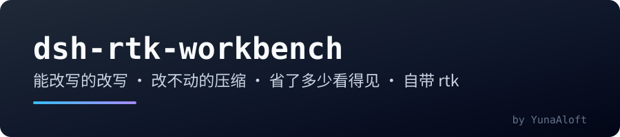
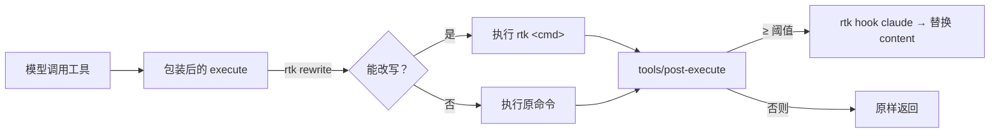

<p align="center">
  
</p>

<p align="center">
  <a href="./README.en.md">English</a> · <strong>中文</strong>
</p>

<p align="center">
  <a href="https://www.npmjs.com/package/dsh-rtk-workbench"></a>
  <a href="https://www.npmjs.com/package/dsh-rtk-workbench"></a>
  <a href="LICENSE"></a>
</p>

<p align="center">
  <em>把 <a href="https://github.com/rtk-ai/rtk">rtk</a> 接进 DeepSeek Harness，二进制一起带上。</em><br>
  <sub>能改写的改写 · 改不动的压缩 · 省了多少看得见</sub>
</p>

## Why this exists

rtk（Rust Token Killer）站在 agent 和工具之间：把命令改写成过滤版，并在模型读到工具输出之前先压一遍。官方为 20 个 agent 写了适配层，DSH 不在其中；社区已有的 DSH 插件也只补了「改写」或「裁剪」的一半。这个插件把三件事一次补齐：**改写**（委托 rtk 的规则）、**压缩**（真 rtk 方法链，不重造引擎）、**可见**（省下的 token 进统计，也在界面上一眼看到）。失败路径全部开放：rtk 缺失、超时或返回意料之外的东西时，工具调用和没装这个插件时一样。它不注册新工具、不替换 shell 执行器、不碰模型 API。

## What you get

| 能力 | 默认 | 说明 |
|---|---|---|
| **命令改写** | 开 | `git status` 以 `rtk git status` 执行，首行标 `[rtk] ran:`；语义守卫确认改写仍在跑原命令（`next build` 走 `rtk next`，丢参数的提案被拒），rtk 跑不起来时重放原命令并标 `[rtk] fell back:` |
| **输出压缩** | 开（≥ 2 KB） | `rtk hook claude` 压缩大输出，文件/搜索结果默认跳过；保留 `rtk recall <hash>`，沙箱够不到 rtk 库时原文落盘并给出路径 |
| **节省可见** | 开 | token 估算（ASCII ÷4、汉字 ×0.6）＋跨重启累计；界面药丸随时可瞥，`/rtk stats` 查明细 |
| **/rtk 命令组** | 常驻 | `status`、`stats`、`tools`、`explain`、`doctor`、`gain`、`recall`、`on/off` |

## Install

在**插件面板**里搜 `dsh-rtk-workbench` 点安装，或者：

```sh
dsh plugin --profile web add dsh-rtk-workbench
```

也可以直接装 GitHub Release 上的 `dsh-rtk-workbench-<platform>.tgz`。装完**重启宿主**（bundle 变更不是刷新页面）。**不需要单独安装 rtk**——平台二进制随包分发，覆盖 Windows x64、macOS x64/arm64、Linux x64/arm64；其它平台见 [参考手册](./docs/reference.zh.md)。

## Quick start

```
/rtk status     # 二进制、pipeline、开关、本会话省量
/rtk stats      # 完整报告；--json 给机器读
/rtk off ui     # 隐藏输入框上方的省量药丸
```

之后正常干活：大仓库里的 `git status` 变成紧凑结果；`cat` 一个 100 KB 日志会被压缩并指向 `rtk recall <hash>`，沙箱里则给出可直接读的落盘路径。`status`、`stats`、`tools`、`explain`、`doctor`、`recall` 的完整说明在参考手册。

## How it works

改写靠包装 `ToolDefinition.execute`（不是重派发），保留注册表的信号融合与记账；压缩在 `tools/post-execute` 里先 `await next()` 再做内容替换，因此安全插件与 spill 策略照常生效。界面侧，宿主半提供只读 `GET /api/rtk-workbench/status`，浏览器半在输入框上方显示「省 X token · −N%」，点开是明细浮层。



## Measured effect

确定性基准合计 **463 507 B → 38 265 B（−91.7 %）**，约 115.9k → 9.6k 估算 token。完整表格、复现方法与「这些数字不能证明什么」见 [基准测试](./docs/benchmark.zh.md)；token 为估算值，不是服务商计费口径。

## Documentation

- [参考手册](./docs/reference.zh.md) —— 命令、配置、恢复、兼容矩阵、排障、设计说明
- [基准测试](./docs/benchmark.zh.md) —— 固定 fixture 的可复现数字与边界
- [兼容性台账](./docs/compatibility.zh.md) —— 已验证宿主、声明范围、`verify-host`
- [变更记录](./CHANGELOG.md) —— 每个版本改了什么

## Development

```sh
pnpm install
pnpm typecheck     # host + client 两个编译面
pnpm test
pnpm build         # lib/index.js（宿主）+ lib/client.js（浏览器）
```

更多脚本（`benchmark`、`release`、`check-manifest`、`check-docs`）见参考手册。

## Credits

压缩规则、过滤器与 `hook` 协议都是 [rtk](https://github.com/rtk-ai/rtk) 的工作；本插件原样分发 rtk 二进制（Apache-2.0，链接 BUSL-1.1 的 `rtk-engine`，两份许可见 [`licenses/`](./licenses)）。

## License

[Apache License 2.0](./LICENSE) © 2026 dsh-rtk-workbench contributors.
