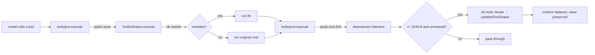

<p align="center">
  
</p>

<p align="center">
  <strong>English</strong> · <a href="./README-zh.md">中文</a> · <a href="./README-es.md">Español</a> · <a href="./README-hi.md">हिन्दी</a> · <a href="./README-pt.md">Português</a>
</p>

<p align="center">
  <a href="https://www.npmjs.com/package/dsh-rtk-workbench"></a>
  <a href="https://www.npmjs.com/package/dsh-rtk-workbench"></a>
  <a href="LICENSE"></a>
</p>

<p align="center">
  <em>Bring <a href="https://github.com/rtk-ai/rtk">rtk (Rust Token Killer)</a> to DeepSeek Harness — and ship the binary with it.</em><br>
  <sub>rewrite what you can · compress what is left · tell the model what happened</sub>
</p>

## Why this exists

rtk works by sitting between the agent and its tools: it rewrites a command into a filtered
variant, and it compresses tool output before the model reads it. It supports 20 agents out of
the box. **DeepSeek Harness is not one of them.**

The existing DSH plugins close that gap only halfway — they all implement *command rewriting*
and stop there. That leaves two thirds of rtk's value unused:

| Gap | Consequence |
|---|---|
| No output compression | Commands rtk cannot rewrite (`node build.js`, `cat big.log`, MCP calls) still dump their full output into the context |
| No awareness section | The model sees `[... elided ...]` and re-runs the command to "get the real output" — paying twice |
| rtk must be installed by hand | A plugin that only works if you install something else first is a plugin that silently does nothing |

This plugin closes all three, and keeps every failure path open: if rtk is missing, slow, or
answers something unexpected, the tool call behaves exactly as it would without the plugin.

## What you get

| Capability | Default | How it works |
|---|---|---|
| **Command rewriting** | on | Wraps `ToolDefinition.execute`; `git status` runs as `rtk git status`, and a result above 500 B starts with `[rtk] ran: …` so the executed command is visible |
| **Tool-output compression** | on (≥ 2048 B) | Runs `rtk hook claude` with a synthetic PostToolUse event in `tools/post-execute`; the condensed text replaces the content while the canonical value stays intact for `run_code` |
| **Awareness section** | on | One static system-prompt section explaining `[rtk] ran:`, the elision markers, and `rtk recall` |
| **Bundled rtk** | on | The binary ships as a per-platform optional package; nothing to install, `rtkSource: 'path'` opts out |
| **rtk `deny` rules** | off | Feeds `rtk hook claude` a PreToolUse event and honours `permissionDecision: deny` |
| **`/rtk` command group** | always | `status`, `tools`, `doctor`, `gain`, `recall <hash>`, and `on` / `off` per switch |

Nothing here registers a new tool, replaces a shell executor, or touches the model API.

## Install

**From the plugin panel** — search `dsh-rtk-workbench` in *Add plugin* and install.

**With the CLI:**

```sh
dsh plugin --profile web add dsh-rtk-workbench
```

**Or straight from a GitHub Release** — no registry involved. Pick the asset for your platform:

| Platform | Asset |
|---|---|
| Windows x64 | `dsh-rtk-workbench-win32-x64.tgz` |
| macOS Intel | `dsh-rtk-workbench-darwin-x64.tgz` |
| macOS Apple silicon | `dsh-rtk-workbench-darwin-arm64.tgz` |
| Linux x64 | `dsh-rtk-workbench-linux-x64.tgz` |
| Linux arm64 | `dsh-rtk-workbench-linux-arm64.tgz` |

```sh
# `latest/download/` always resolves to the newest release, so the URL survives upgrades
dsh plugin --profile web add https://github.com/YunaAloft/dsh-rtk-workbench/releases/latest/download/dsh-rtk-workbench-win32-x64.tgz
```

Asset names carry no version on purpose: a versioned file name would break every
`releases/latest/download/` link on the next release. Which version you got is visible in
`/rtk status` (`version : rtk 1.1.0`) and in the release tag.

Restart the host (a bundle change is not a page reload). **You do not need to install rtk
separately** — the platform binary is an optional dependency of this package:

| # | Resolution order |
|---|---|
| 1 | `rtkPath` config |
| 2 | `RTK_BIN` / `DSH_RTK_BIN` |
| 3 | the bundled platform package (or `vendor/` inside a release tarball) |
| 4 | `rtk` on `PATH` |

A platform package that fails to download simply loses its turn, so the plugin degrades to
"use the rtk you installed" instead of failing.

## Quick start

```
/rtk status     # binary, provenance, pipeline, switches, what was patched
/rtk doctor     # deep self-check: version, pipeline, a real round trip, recall
/rtk tools      # how each visible tool resolved (canonical / alias / explicit)
```

Then just work normally:

- ask the agent to run `git status` in a big repository → the result begins with
  `[rtk] ran: …` and contains the compact one-line-per-file form (tiny clean trees stay
  un-annotated on purpose: the line costs more than it saves there);
- ask it to `cat` a 100 KB log → the result is condensed, ending with
  `[full output: rtk recall <hash>]`;
- paste that hash back and ask for `rtk recall <hash>` → the original comes back in full.

## How it works



Three details matter for correctness, and each cost a real bug to learn:

1. **Patching, not re-dispatching.** A `tools/execute` listener that skips `next()` loses the
   registry's signal fusion and `bodyInvoked` bookkeeping, degrading cancellation. Patching
   `execute` keeps that machinery intact and substitutes one argument.
2. **`await next()` first.** A `tools/post-execute` listener that returns early short-circuits
   every listener behind it — including other plugins' notices.
3. **The annotation never eats the body.** If a result cannot be read as text, or the tool is
   not compressible, the annotation is added as its own block or skipped — never the other way
   round.

## Measured effect

Reproduce with `node scripts/benchmark.mjs`: it builds a deterministic fixture repository,
then measures each case twice — once raw, once through the same path the plugin uses
(`rtk <command>` for rewriting, a synthetic PostToolUse event through `rtk hook claude` for
compression).

| Case | Path | Before | After | Saved | Est. tokens |
|---|---|---:|---:|---:|---:|
| `git status` | rewrite | 377 B | 47 B | −87.5 % | 95 → 12 |
| `git log`, 20 commits | rewrite | 3 578 B | 1 698 B | −52.5 % | 895 → 425 |
| `git diff`, 100 changed lines | rewrite | 20 511 B | 6 945 B | −66.1 % | 5 128 → 1 737 |
| `ls -la` | rewrite | 508 B | 138 B | −72.8 % | 127 → 35 |
| `grep -rn TODO src`, 300 hits | rewrite | 20 364 B | 2 190 B | −89.2 % | 5 091 → 548 |
| pytest output, 2 001 lines | compress | 89 505 B | 11 287 B | −87.4 % | 22 377 → 2 822 |
| application log, 5 000 lines | compress | 272 640 B | 13 633 B | −95.0 % | 68 160 → 3 409 |
| `package-lock.json`, `read` shape | compress | 76 896 B | 4 654 B | −93.9 % | 19 224 → 1 164 |
| **Total, one call each** | | **484 379 B** | **40 592 B** | **−91.6 %** | **121 095 → 10 148** |

> These are bytes, not tokens: the token column is `bytes / 4`, an estimate for ASCII-heavy
> text — read it as an order of magnitude. The fixture is synthetic on purpose (repetitive
> logs, a 300-`TODO` file, a generated lockfile), so re-run the script on your own workload
> before quoting a number.

Latency per round trip (30 samples, `process.hrtime`):

| Operation | p50 |
|---|---|
| `rtk --version` (process start only) | 50 ms |
| `rtk hook claude`, 8.4 KB payload | 96 ms |
| `rtk rewrite "git status"` | 206 ms |
| First spawn in a fresh host process | 2.7–5.8 s (the platform scanning a 17 MB unsigned binary) |

That is why the compression threshold is 2048 bytes, why an already-`rtk` command never spends a
spawn, and why the start-up probe gets its own budget instead of blocking a tool call.

## Coexistence

The plugin is built to sit next to whatever else you run:

- **It does not take `ctx.shell`.** Rewriting happens by wrapping the registered tool, so a
  plugin that replaces the shell executor keeps working.
- **It always awaits `next()`** in `tools/post-execute`, so a safety plugin's "this command was
  not checked" notice and the spill policy still run.
- **It never names or blocks other plugins.** If another listener already replaced a result's
  content, the plugin notices (a content diff, nothing more), keeps working, and reports
  `observed: another result transformer changed N result(s)` in `/rtk status`.
- **`deny` is off by default**, because command blocking usually belongs to a dedicated safety
  plugin; `rtk`'s `allow` rules are what this plugin honours when it is on.

## Configuration

Every knob is a Schemastery schema; invalid values fail at load instead of at runtime.

| Key | Type | Default | Description |
|---|---|---|---|
| `rtkPath` | string | `''` | Explicit binary; empty = `RTK_BIN` / `DSH_RTK_BIN` / bundled / `PATH` |
| `rtkSource` | string | `'auto'` | `auto` prefers the bundled binary, `path` always resolves through `PATH` |
| `timeoutMs` | number | `2000` | Per-invocation budget; a timeout means no rewrite and no compression |
| `rewriteEnabled` | boolean | `true` | Master switch for rewriting |
| `shellTools` | string[] | `['bash','pwsh']` | Tool names treated as shells for detection |
| `rewriteTools` | string[] | `['bash','ops_bash','pwsh']` | Eligible for rewriting; a local pre-filter skips PowerShell cmdlets and `$`-expressions, which rtk always defers on |
| `compressEnabled` | boolean | `true` | Master switch for compression |
| `compressTools` | string[] | `['*']` | Eligible tools; `*` = every tool's text result |
| `excludeTools` | string[] | `[]` | Never touched, regardless of other lists |
| `compressThresholdBytes` | number | `2048` | Below this the ~96 ms spawn is not worth it |
| `maxPayloadBytes` | number | `2097152` | Above this skip (rtk caps hook stdin at 64 MiB) |
| `awarenessEnabled` | boolean | `true` | Inject the awareness section |
| `denyEnabled` | boolean | `false` | Honour rtk's `deny` verdict |
| `pipelineMode` | string | `'plugin-owned'` | `plugin-owned` injects `RTK_CONFIG_DIR`; `user` relies on your own pipeline file |
| `annotateRewrites` | boolean | `true` | Prepend the `[rtk] ran:` line |
| `annotateMinBytes` | number | `500` | Skip that line when the result is shorter than this — it names a full path, so on a tiny result it costs more than the rewrite saved |

`RTK_DB_PATH` and `RTK_TEE_DIR` are deliberately **not** overridden: `rtk recall` is run by the
model through the ordinary shell, and redirecting the tee/DB would make recovery impossible.

## Troubleshooting

**`/rtk status` says `rtk is not usable`.** The line names the reason (`spawn`, `timeout` or
`exit`). The first spawn in a fresh process can take seconds — a `timeout` there is usually the
platform scanning the binary, not a broken install. If it says `via path`, the bundled package
for your platform did not install; set `rtkPath` or install rtk yourself.

**Compression never fires.** Check `/rtk tools`: a tool without a `compress` mark is not in
`compressTools`, or the result is below `compressThresholdBytes`. If the command was rewritten,
skipping compression is correct — rtk already produced the compact output.

**Rewriting never fires.** `Get-ChildItem` and `$env:PATH` are PowerShell grammar; rtk defers on
them by design, so the plugin does not even spend a process. `git status`, `cargo test`,
`docker ps` and `ls` are rewritten normally.

**`rtk recall` fails with a store error.** The tool shell is sandboxed (`workspace-write`) and cannot
reach rtk's database in `%APPDATA%`; the plugin itself runs outside that sandbox. Ask the user to run
`/rtk recall <hash>` — a slash command runs in the host process and reads the same store.

**Two compressors at once.** `/rtk status` shows `observed: another result transformer …` when
something downstream replaced a result's content. Nothing breaks, but keeping one compressor is
usually better — `/rtk off compress` turns this one off for the session.

**Nothing works in a brand-new profile.** Windows profiles may ship only the `pwsh` tool. That is
enough for compression and for rewriting real programs; a `bash` tool appears only if a shell
plugin provides one.

## Development

```sh
pnpm install
node node_modules/typescript/bin/tsc --noEmit
node node_modules/vitest/vitest.mjs run
node node_modules/tsdown/dist/run.mjs          # build lib/
node scripts/build-vendor.mjs                  # bundle rtk (downloads ~31 MB, cached)
node scripts/release.mjs --dry-run             # show the publish plan
npx dsh-plugin-dev check --cwd . --strict
npx dsh-plugin-dev verify --cwd . \
  --base @deepseek-ai/dsh-base@0.2.1-rc.5 \
  --headless @deepseek-ai/dsh-headless@0.2.1-rc.5
```

`scripts/smoke-rtk.mjs <binary>` proves a bundled binary runs on the current platform. CI runs it on
every platform we ship — Ubuntu x64/arm64, macOS arm64/x64 and Windows — while the unit suite runs on
Ubuntu, macOS arm64 and Windows.

Pushing a change under `.github/workflows/` needs the `workflow` token scope; run
`gh auth refresh -s workflow` once and the next push goes through.

**Releasing.** Build every platform (`node scripts/build-vendor.mjs` with no `--only`), then publish
the five platform packages and the main package in that order:

```sh
node scripts/release.mjs --yes --registry https://registry.npmjs.org
gh release create v0.1.0 dist/github/*.tgz dist/github/checksums.txt dist/github/manifest.json \
  --title "dsh-rtk-workbench v0.1.0 (rtk 1.1.0)" --generate-notes
```

`release.mjs` then polls the registry until all six packages really serve the version: a new package
is accepted with HTTP 202 and served as `0.0.0-stage` until its staged release is approved, so a
successful publish is not yet an installable one. Skip the wait with `--no-verify`.

The order matters: the main package lists the platform packages as `optionalDependencies`, so
publishing it first would make every install resolve zero binaries. The platform packages are named
`dsh-rtk-workbench-<platform>` and carry the same version as the main package; the bundled rtk
version lives in `dshRtkVersion`.

## Credits

The compression rules, filters and the `hook` protocol are [rtk](https://github.com/rtk-ai/rtk)'s
work (Apache-2.0); this plugin is the DeepSeek Harness adapter and ships rtk 1.1.0 unmodified.
Its license is reproduced in [`licenses/rtk-LICENSE`](./licenses/rtk-LICENSE).

## License

[Apache License 2.0](./LICENSE) © 2026 dsh-rtk-workbench contributors.
