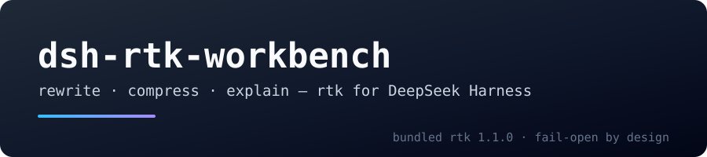
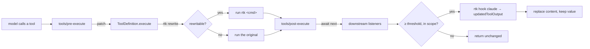

<p align="center">
  
</p>

<p align="center">
  <strong>English</strong> · <a href="./README-zh.md">中文</a>
</p>

<p align="center">
  <a href="https://www.npmjs.com/package/dsh-rtk-workbench"></a>
  <a href="https://www.npmjs.com/package/dsh-rtk-workbench"></a>
  <a href="LICENSE"></a>
</p>

<p align="center">
  <em>Bring <a href="https://github.com/rtk-ai/rtk">rtk (Rust Token Killer)</a> to DeepSeek Harness — and ship the binary with it.</em><br>
  <sub>rewrite what you can · compress what is left · tell the model what happened</sub>
</p>

## Why this exists

rtk sits between the agent and its tools: it rewrites commands into filtered
equivalents and condenses tool output before the model reads it. It ships an
adapter for each of 20 agents — for Claude Code that is a `PreToolUse` hook.
DeepSeek Harness had no such adapter, and existing DSH plugins only implemented
the rewrite half.

- No output compression: commands rtk cannot rewrite still put their full output into context.
- No context note: the model sees `[... elided ...]`, assumes the result is incomplete, and re-runs the command.
- No bundled binary: a plugin that only works once you install rtk somewhere else silently does nothing.

This plugin closes all three and keeps every failure path open: if rtk is
missing, slow, or answers something unexpected, the tool call behaves exactly as
it would without the plugin.

## What you get

| Capability | Default | How it works |
|---|---|---|
| **Command rewriting** | on | Wraps `ToolDefinition.execute`; `git status` runs as `rtk git status`, and a result above 500 B starts with `[rtk] ran: rtk git status`. A rewrite rtk could not run is replayed as the original and labelled `[rtk] fell back:` |
| **Output compression** | on (≥ 2048 B) | `rtk hook claude` with a synthetic PostToolUse event in `tools/post-execute`; file/search results are skipped, small test/build output uses per-verb thresholds |
| **Recovery** | on | rtk's `rtk recall <hash>` hint stays; when the sandbox cannot reach rtk's store, the original is spilled to session-private storage and named in the result |
| **Session visibility** | on | `/rtk status` appends this session's savings and skip reasons; `/rtk stats [--json]` is the full report |
| **Awareness section** | on | One static prompt section explaining `[rtk] ran:`, `[rtk] fell back:`, elisions, `rtk recall` and the saved-path form; registered only after rtk is proven usable |
| **Bundled rtk** | on | The binary ships as a per-platform optional package; nothing to install, `rtkSource: 'path'` opts out |
| **rtk `deny` rules** | off | Feeds `rtk hook claude` a PreToolUse event and honours `permissionDecision: deny`; DSH has no host permission rules, so this stays off |
| **`/rtk` commands** | always | `status`, `stats`, `tools`, `explain`, `doctor`, `gain`, `recall <hash>`, `help [topic]`, `on`/`off` per switch |

Nothing here registers a new tool, replaces a shell executor, or touches the model API.

## Install

**From the plugin panel** — search `dsh-rtk-workbench` in *Add plugin* and install, or:

```sh
dsh plugin --profile web add dsh-rtk-workbench
```

**Or straight from a GitHub Release** — pick the asset for your platform:

| Platform | Asset |
|---|---|
| Windows x64 | `dsh-rtk-workbench-win32-x64.tgz` |
| macOS Intel | `dsh-rtk-workbench-darwin-x64.tgz` |
| macOS Apple silicon | `dsh-rtk-workbench-darwin-arm64.tgz` |
| Linux x64 | `dsh-rtk-workbench-linux-x64.tgz` |
| Linux arm64 | `dsh-rtk-workbench-linux-arm64.tgz` |

**Restart the host after installing** (a bundle change is not a page refresh).
You do not need to install rtk separately: the platform binary is an optional
dependency of this package.

## Quick start

```
/rtk status     # binary, provenance, pipeline health, switches, this session's savings
/rtk stats      # full session report (--json for machines)
/rtk doctor     # deep self-check: version, pipeline, a real round trip, recall, trust
/rtk tools      # how each visible tool resolved (canonical / alias / explicit)
/rtk explain "git status"   # why a command would (not) be rewritten
```

Then work normally: a big `git status` comes back as a compact one-line-per-file
result prefixed with `[rtk] ran: rtk git status`; a `cat` of a 100 KB log is
condensed and points at `rtk recall <hash>` — or, in a sandboxed session, at an
`[rtk] original saved: <path>` file you can read.

## How it works



Rewriting patches `execute` instead of re-dispatching, so the registry's signal
fusion and accounting stay intact; compression always awaits `next()` first, so
security and spill listeners still run. The detailed rules are in the reference
manual.

## Measured effect

| Case | Path | Before | After | Drop |
|---|---|---:|---:|---:|
| `git status` | rewrite | 377 B | 47 B | −87.5 % |
| `grep -rn TODO src`, 300 hits | rewrite | 20 364 B | 2 190 B | −89.2 % |
| pytest output, 2 001 lines | compress | 89 505 B | 11 287 B | −87.4 % |
| `package-lock.json`, read shape | compress | 76 896 B | 4 654 B | −93.9 % |

`node scripts/benchmark.mjs` reproduces this on a deterministic fixture; the
fixture is deliberately repetitive, so re-run it on your own workload before
quoting numbers. This is bytes, not tokens: the reference manual explains the
thresholds this table justifies.


## Documentation

- [Reference manual](./docs/reference.md) — commands, configuration, recovery, compatibility matrix, troubleshooting, design notes.
- [中文手册](./docs/reference.zh.md) — the same manual in Chinese.

## Development

```sh
pnpm install
node node_modules/typescript/bin/tsc --noEmit
node node_modules/vitest/vitest.mjs run
node node_modules/tsdown/dist/run.mjs          # build lib/
node scripts/build-vendor.mjs                  # package rtk (downloads ~31 MB, cached)
node scripts/release.mjs --dry-run             # print the release plan
node scripts/check-manifest.mjs                # package-level requirements (parsed YAML, peers, files, display meta)
node scripts/check-docs.mjs                    # README pairing and relative-link integrity
```

`scripts/smoke-rtk.mjs <binary>` verifies a bundled binary. CI runs the smoke on
every shipped platform and the unit suite on Ubuntu, macOS arm64 and Windows.

## Credits

Compression rules, filters and the `hook` protocol are [rtk](https://github.com/rtk-ai/rtk)'s
work; this plugin is the DeepSeek Harness adapter and redistributes the rtk
binary unchanged. That binary is Apache-2.0 and links `rtk-engine` under
BUSL-1.1 (source-available; production use is free and the license converts to
Apache-2.0 on 2030-09-09, but rtk may not be offered as a paid or hosted
product). Both texts ship in [`licenses/`](./licenses).

## License

[Apache License 2.0](./LICENSE) © 2026 dsh-rtk-workbench contributors.
